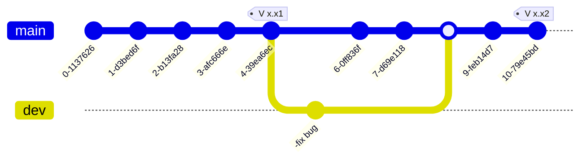

---
Title | Tools Git
-- | --
Created @ | `2018-12-14T07:40:51Z`
Updated @| `2026-11-10T06:07:21Z`
Labels | ``
Edit @| [here](https://github.com/junxnone/xwiki/issues/111)

---
# Git

Git 是分布式版本控制系统，由 Linus Torvalds 为管理 Linux 内核源码而开发（2005）。每个克隆都是一份完整的仓库，提交、分支、查看历史大多在本地完成，不依赖网络和中心服务器。

## 目录

主题 | 文章
-- | --
配置 | [Git Configs](/0112_Tools_Git_config)、[Git config proxy](/0113_Tools_Git_config_proxy)、[Github SSH Key](/0123_Tools_Github_SSHKey)、[Github Token](/0307_Tools_Github_Token)、[多账号切换](/0329_Tools_Github_多账号切换)
分支与合并 | [Git branch](/0115_Tools_Git_branch)、[Git Rebase](/0274_Tools_Git_Rebase)、[Git diff](/0277_Tools_Git_diff)
暂存与撤销 | [Git stash](/0331_Tools_Git_stash)、[移除 stage 文件](/0119_Tools_Git_RMStageFile)
标签与发布 | [Git tag](/0116_Tools_Git_tag)、[Git archive](/0118_Tools_Git_archive)
补丁与子模块 | [Git Patch](/0226_Tools_Git_Patch)、[Git submodule](/0114_Tools_Git_submodule)
钩子与检查 | [Git precommit](/0117_Tools_Git_precommit)
问题记录 | [No newline at end of file](/0120_Tools_Git_NoNewline)
Github | [Github Pages](/0126_Tools_Github_Pages)、[Github actions](/0122_Tools_Github_actions)、[Pull Requests](/0301_Tools_Github_PullRequests)

## 简单的开发流程



## 基本概念

概念 | 说明
-- | --
工作区 (working tree) | 磁盘上实际看到、编辑的文件
暂存区 (index / stage) | `git add` 之后存放“下次要提交的内容”的地方
本地仓库 (repository) | `.git` 目录，保存所有提交历史
远端 (remote) | 其他位置的仓库，常见名字 `origin`
HEAD | 当前所在的提交（通常通过当前分支间接指向）
分支 (branch) | 指向某个提交的可移动指针，创建和切换都很轻量
标签 (tag) | 指向某个提交的固定名字，常用于发布版本

文件在三个区域之间的流转：

```
工作区 ──git add──▶ 暂存区 ──git commit──▶ 本地仓库 ──git push──▶ 远端
  ▲                    │                       │                     │
  └──git restore───────┘◀────git reset──────────┘◀────git fetch/pull───┘
```

## 常用命令速查

### 初始化与克隆

```bash
git init                                # 在当前目录创建仓库
git clone <url>                         # 克隆
git clone --depth 1 <url>               # 浅克隆，只取最新一次提交
git clone --recursive <url>             # 连同子模块一起克隆
```

### 提交

```bash
git status                              # 查看状态（加 -s 简洁输出）
git add file                            # 暂存文件
git add -p                              # 交互式挑选要暂存的代码块
git commit -m "msg"                     # 提交
git commit --amend                      # 修改最近一次提交（说明或补充文件）
git commit --amend --no-edit            # 补充文件但不改说明
```

### 查看历史与差异

```bash
git log --oneline --graph --all --decorate    # 图形化历史（可设别名 git lg）
git log -p file                               # 某个文件的历史改动
git log --author="name" --since="2 weeks ago"
git show <commit>                             # 查看某次提交
git diff                                      # 工作区 vs 暂存区
git diff --staged                             # 暂存区 vs 最近提交
git blame file                                # 每一行是谁、在哪次提交改的
```

### 远端

```bash
git remote -v                           # 查看远端
git remote add origin <url>             # 添加远端
git remote set-url origin <new-url>     # 修改远端地址
git fetch                               # 只获取，不合并
git pull                                # fetch + merge（--rebase 则是 fetch + rebase）
git push -u origin main                 # 首次推送并建立跟踪关系
git push                                # 之后直接推送
```

### 撤销与回退

场景 | 命令
-- | --
撤销工作区某个文件的修改 | `git restore file`
把文件移出暂存区（保留修改） | `git restore --staged file`
撤销最近一次提交，改动留在暂存区 | `git reset --soft HEAD~1`
撤销最近一次提交，改动留在工作区 | `git reset --mixed HEAD~1`（默认）
撤销最近一次提交并丢弃改动 | `git reset --hard HEAD~1`（**危险**）
生成一个新提交来抵消某次提交 | `git revert <commit>`（已推送的提交用这个）
找回“丢失”的提交 | `git reflog` 找到 sha，再 `git switch -c <name> <sha>`

> `reset` 会改写历史，已推送到共享分支的提交不要 `reset` 后强推；用 `revert`。强推用 `--force-with-lease`，比 `--force` 安全。

### 分支与合并

```bash
git branch                              # 本地分支
git branch -a                           # 含远程分支
git switch -c feature                   # 新建并切换（旧写法 git checkout -b）
git switch main                         # 切换
git merge feature                       # 合并到当前分支
git rebase main                         # 把当前分支变基到 main 之上
git branch -d feature                   # 删除已合并分支
git cherry-pick <commit>                # 把某次提交摘到当前分支
```

### 暂存现场与清理

```bash
git stash push -m "msg"                 # 临时存起未提交改动
git stash pop                           # 取回
git clean -nd                           # 预览会被删除的未跟踪文件
git clean -fd                           # 删除未跟踪文件和目录
```

## 配置要点

```bash
git config --global user.name  "your_name"
git config --global user.email "your_email"
git config --global core.editor "vim"
git config --global init.defaultBranch main
git config --global pull.rebase true         # pull 时默认用 rebase
git config --global alias.lg "log --oneline --graph --all --decorate"
git config --list --show-origin              # 查看所有配置及来源
```

- 配置分三级：`--system`（整台机器）、`--global`（当前用户，`~/.gitconfig`）、`--local`（当前仓库，`.git/config`），后者覆盖前者。
- 按目录区分身份：在 `~/.gitconfig` 里用 `[includeIf "gitdir:~/work/"] path = ~/.gitconfig-work`，目录下的仓库自动使用另一套 name/email。
- 代理、SSH Key、Token 详见上面“配置”一行的链接。

## .gitignore

- 放在仓库根目录或子目录，每行一个模式：`*.log`、`build/`、`!keep.log`（取反）。
- 已被跟踪的文件，后加进 `.gitignore` 不会生效，需要先 `git rm --cached file`。
- 全局忽略：`git config --global core.excludesfile ~/.gitignore_global`。

## Issues
- [Git 移除 stage 错误添加的文件](/0119_Tools_Git_RMStageFile)
- [No newline at end of file](/0120_Tools_Git_NoNewline)

## gitlab 手动迁移到 github

- 只添加 remote 再 `git push`，只会迁移当前分支。

### 迁移所有分支和 tag（推荐：镜像推送）

```bash
git clone --mirror <gitlab_url> repo.git     # 完整镜像，含所有分支、tag
cd repo.git
git push --mirror <github_url>
```

> `--mirror` 会让目标仓库与源完全一致（包括删除目标上多出来的引用），目标应是一个空仓库。

### 已有本地仓库时

```bash
git remote add github_remote <github_url>
git push github_remote --all                 # 推送所有本地分支
git push github_remote --tags                # 推送所有 tag
```

- `--all` 只推送**本地已存在**的分支。只在远程存在的分支，要先 `git branch --track <name> origin/<name>` 建立本地分支，或直接用上面的 `--mirror` 方式。

## 内部原理

- Git 是一个**内容寻址的键值存储**：对象存在 `.git/objects` 下，以内容的 SHA-1（新仓库可选 SHA-256）命名。
- 四种对象：
  - `blob`：文件内容
  - `tree`：目录，记录名字到 blob/tree 的映射
  - `commit`：指向一个 tree，加上父提交、作者、说明
  - `tag`：带附注的标签对象，指向某个对象
- 分支和标签只是 `.git/refs/` 下保存 sha 的小文件；`HEAD` 通常指向当前分支（`ref: refs/heads/main`）。
- 暂存区是 `.git/index` 二进制文件，记录“下一次提交的目录快照”。
- 历史是由 commit 通过父指针组成的**有向无环图**，所以分支廉价，合并只是多出一个有两个父提交的 commit。
- 对象多了之后，`git gc` 会把松散对象打包成 packfile，用增量压缩节省空间。

可以用底层命令亲自看一下：

```bash
git cat-file -t HEAD            # 对象类型
git cat-file -p HEAD            # 内容：tree、parent、author、message
git cat-file -p HEAD^{tree}     # 根目录的内容
git ls-files --stage            # 暂存区内容
```

## Reference
- [Pro Git（中文版）](https://git-scm.com/book/zh/v2)
- [Git 官方文档](https://git-scm.com/docs)
- [Git内部原理介绍](https://cloud.tencent.com/developer/article/1369947)
- [git-tips](https://github.com/jaywcjlove/git-tips)

