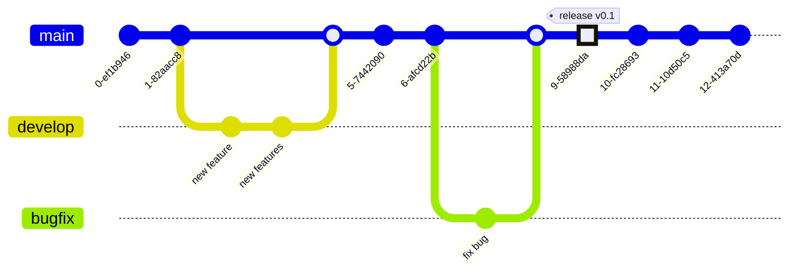

---
Title | Tools Git branch
-- | --
Created @ | `2019-03-25T11:02:40Z`
Updated @| `2026-11-10T06:06:41Z`
Labels | ``
Edit @| [here](https://github.com/junxnone/xwiki/issues/115)

---
# Git Branch

分支是指向某个提交的**可移动指针**，创建、切换都很轻量。分支让不同的开发工作互不干扰，完成后再合并回来。

**分支介绍**
- master/main ：这个分支的代码是发布到生产的代码
- develop ：这个分支的代码是预发布到生产的代码
- release ：这个分支的代码是新版本发布到生产的代码
- feature ：这个分支的代码是新需求开发的代码
- hotfix(bugfix) ：这个分支的代码是紧急修复生产 bug 的代码




## UseCase

Usecase| 命令 
-- | --
新建 Branch  | `git branch dev`
新建并切换到 Branch | `git switch -c dev`（旧写法 `git checkout -b dev`）
切换 Branch | `git switch dev`（旧写法 `git checkout dev`）
基于某个提交/tag 新建分支 | `git switch -c fix <commit-or-tag>`
列出当前 Branch | `git branch`
列出所有 Branch | `git branch -a`	
列出所有 Remote Branch | `git branch -r`
查看每个分支最后一次提交及跟踪关系 | `git branch -vv`
列出已合并 / 未合并到当前分支的分支 | `git branch --merged` / `git branch --no-merged`
重命名当前分支 | `git branch -m new-name`
删除已合并的本地 Branch | `git branch -d branchname`
强制删除本地 Branch（未合并也删） | `git branch -D branchname`
删除 Remote Branch | `git push origin --delete branch_name`<br>`git push origin :branch-name`（旧写法）<br>`git branch -r -d origin/branch-name`（只删除本地的远程跟踪引用，不会删除远端分支）
合并 Branch 到 Master | `git switch master`<br>`git merge dev`
Remote Branch 已删除<br>但 Local 仍能看到 | `git remote prune origin`<br>`git fetch --prune`
show all branch details | `git show-branch`
命令行显示分支路线| `git log --graph --all --oneline`
push 当前 A 分支到远程 B 分支 | `git push origin branch_A:branch_B`
首次推送并建立跟踪关系 | `git push -u origin dev`
为已有分支设置上游 | `git branch -u origin/dev`
签出远程分支到本地 | `git switch dev`（本地没有同名分支时自动创建并跟踪 `origin/dev`）<br>`git switch -c dev origin/dev`

## 合并分支

```bash
git switch main
git merge dev                  # 默认：能快进就快进，否则产生合并提交
git merge --no-ff dev          # 始终产生合并提交，保留分支的存在痕迹
git merge --squash dev         # 把 dev 的所有提交压成一份改动放到暂存区，再手动 commit
git merge --abort              # 合并过程中放弃
```

- 快进（fast-forward）：main 没有新提交，只是把指针往前挪；`--no-ff` 则强制多一个合并提交。
- 冲突：打开冲突文件，处理 `<<<<<<<` / `=======` / `>>>>>>>` 标记，`git add` 后 `git commit`。
- 想保持线性历史，用 [rebase](/0274_Tools_Git_Rebase)。

## 临时保存与同步

- 切分支前有未提交的改动：[git stash](/0331_Tools_Git_stash)。
- 同时在多个分支上工作：`git worktree add ../dir branch`，每个分支一个独立目录，不用来回切换。

## 常见分支模型

模型 | 特点 | 适合
-- | -- | --
Git Flow | `main` + `develop` + `feature` / `release` / `hotfix`，流程严格 | 有明确版本发布周期的项目
Github Flow | `main` + 短期 feature 分支 + Pull Request | 持续交付、Web 服务
Trunk-based | 几乎都在 `main` 上，分支生命周期很短，配合 feature flag | 成熟 CI/CD 的团队

## 命名建议

- 用前缀分类：`feature/xxx`、`bugfix/xxx`、`hotfix/xxx`、`release/x.y`。
- 全小写、用 `-` 分隔，避免空格和中文，可带 issue 编号：`feature/123-login-page`。
- 分支名不能以 `-` 开头、不能含空格、`~`、`^`、`:`、`..` 等字符。

## 保护主分支

- 在 Github/Gitlab 上为 `main` 开启保护：禁止直接 push、强制 push，要求 Pull Request 和通过 CI 才能合并。

## Reference
- [成熟的 Git 分支模型](https://my.oschina.net/liebrother/blog/2990683)
- [git-branch 官方文档](https://git-scm.com/docs/git-branch)
- [Pro Git: 分支简介](https://git-scm.com/book/zh/v2/Git-分支-分支简介)
- [Pro Git: 分支的新建与合并](https://git-scm.com/book/zh/v2/Git-分支-分支的新建与合并)

